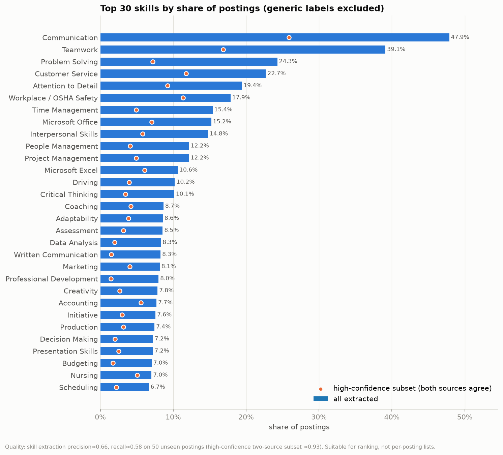

# LinkedIn Job Skills Demand Analysis

A rule-based pipeline that extracts skills, education, experience and certificate requirements
from 1.35 million LinkedIn job postings, then summarises what employers ask for by occupation
group, country and seniority.

> **Status: preliminary.** The full run over all 1,348,454 postings is still in progress.
> Every result in this repository comes from the first 300,000 postings (259,589 after
> deduplication). That slice is not a random sample; see [Pilot caveat](#pilot-caveat).
> The numbers will be updated when the full run finishes.

Link to the Streamlit Dashboard is: https://linkedin-job-skills-datasets-analysis.streamlit.app/
## Contents

- [Overview](#overview)
- [Key findings](#key-findings)
- [Data](#data)
- [Pipeline](#pipeline)
- [Validation and data quality](#validation-and-data-quality)
- [Repository layout](#repository-layout)
- [Quickstart](#quickstart)
- [Limitations](#limitations)
- [Acknowledgements and license](#acknowledgements-and-license)

## Overview

**Question.** Which skills and qualifications do employers ask for, and how do they differ
across occupations, countries and job levels?

**Data.** 1,348,454 LinkedIn postings from the United States, United Kingdom, Canada and
Australia, published on Kaggle in 2024.

**Method.** A dictionary and context-rule extractor reads each job description and combines the
result with LinkedIn's own skill list. The rules were tuned on labelled postings, frozen, and
then evaluated on postings they had never seen. Analysis runs on small aggregated tables.

**Outputs.**

| Output | Location |
|---|---|
| EDA report with eight figures | [`outputs/eda_report.md`](outputs/eda_report.md), `outputs/figures/` |
| Clustering and classification report | [`outputs/models_report.md`](outputs/models_report.md) |
| Aggregated summary tables | `outputs/summary/pilot/` |
| Validation report | [`cleaned/final_eval_v8.md`](cleaned/final_eval_v8.md) |
| Streamlit dashboard (eight pages) | `app/streamlit_app.py`, runs locally; see [Quickstart](#quickstart) |



## Key findings

These are preliminary results from the 300,000-posting pilot slice. Shares are percentages of
deduplicated postings unless stated otherwise.

1. **Soft skills lead the ranking.** Communication appears in 47.9% of postings and Teamwork in
   39.1%. Seven of the top ten skills are soft skills. The most common hard skill is workplace
   safety (17.9%).
2. **Each occupation group has a signature skill.** Litigation appears in 45.5% of legal
   postings, 40 times the overall rate. Food Preparation appears in 33.6% of hospitality
   postings (19 times). Nursing appears in 83.6% of nursing postings (12 times).
3. **The soft/hard mix varies by group.** Soft skills make up 40.5% of skill mentions overall.
   The share ranges from 30.7% in tech and engineering to 60.5% in legal and compliance.
4. **Most postings do not state formal requirements.** Only 22.3% state a degree; of those,
   75.9% ask for a bachelor's or higher. Only 30.6% state years of experience; the median
   minimum is 3 years.
5. **A driver's licence is the most requested credential** (9.2% of postings), followed by RN
   (4.4%) and CPR (2.1%).
6. **Skills alone partly identify the occupation group.** A logistic regression on the skill
   set predicts 12 groups with accuracy 0.44 and macro-F1 0.44, against a majority baseline of
   0.28 and 0.04. Nursing (F1 0.73) and finance (0.68) are easy to recognise. The broad
   management and admin group is not (0.25). Skill clusters are soft themes, not well-separated
   groups (cosine silhouette about 0.06).

### Pilot caveat

The full run processes postings in `job_link` order, so a partial slice is not a random sample.
In the first 300,000 rows, Australia, Canada and the UK are essentially complete. The US rows
cover only job titles early in the alphabet. The US is 32% of the pilot slice but 85% of the
full corpus.

Treat overall and US figures as provisional. Within-group patterns for Australia, Canada and
the UK are the most reliable part of the pilot.

## Data

Source: [1.3M LinkedIn Jobs & Skills (2024)](https://www.kaggle.com/datasets/asaniczka/1-3m-linkedin-jobs-and-skills-2024)
on Kaggle.

| File | Content |
|---|---|
| `linkedin_job_postings.csv` | One row per posting: title, company, location, search country, search position, job level, job type |
| `job_skills.csv` | LinkedIn's skill list for each posting |
| `job_summary.csv` | Full job description text |

| Country | Postings | Share |
|---|---|---|
| United States | 1,149,342 | 85.2% |
| United Kingdom | 113,421 | 8.4% |
| Canada | 55,972 | 4.2% |
| Australia | 29,719 | 2.2% |

**The raw data is not in this repository.** Neither are row-level outputs or job description
text. Only small aggregated tables are committed. To rerun the extraction, download the three
CSV files from Kaggle and place them in the repository root.

## Pipeline

| Step | What it does | Code | Output |
|---|---|---|---|
| 1 | Clean and join the three CSV files | `01_data_overview_and_cleaning.ipynb`, `02_join_datasets.ipynb`, `03_combine_and_clean.ipynb` | `cleaned/jobs_combined.parquet` |
| 2 | Extract skills, education, experience and certificates with the frozen v8 rules | `run_pipeline_v8.py`, `extraction_resources.py`, `skill_refinement.py` | Per posting: skills with source and evidence, `edu_required`, `yoe_min_overall`, certificates |
| 3 | Map LinkedIn's 1,993 `search_position` values to 12 occupation groups plus Other | `search_position_groups.py`, `config/search_position_groups.csv` | `position_group` |
| 4 | Run the extraction over the full corpus in resumable chunks | `run_full_v8.py` | `outputs/full_v8/` |
| 5 | Build aggregated summary tables | `src/analysis/build_summaries.py` | `outputs/summary/<name>/` |
| 6 | Produce figures and the EDA report | `src/analysis/eda.py` | `outputs/figures/`, `outputs/eda_report.md` |
| 7 | Cluster skill profiles and predict occupation group | `src/analysis/models.py` | `outputs/models_report.md` |
| 8 | Skill bundles and occupation-transition gaps (curriculum view) | `src/analysis/curriculum.py` | `outputs/summary/<name>/curriculum/`, `outputs/curriculum_report.md` |
| 9 | Serve the dashboard from the summary tables | `app/streamlit_app.py` | Local web app |

Skills come from two sources: LinkedIn's `job_skills` list and a dictionary and context match on
the description text. A skill found in both sources is flagged `high_confidence`.

[`CHANGELOG.md`](CHANGELOG.md) describes how the rules evolved up to the v8 freeze.

## Validation and data quality

The rules were tuned on 150 labelled postings and checked on a 50-posting holdout. They were
then frozen (`RULES_FROZEN_v8.txt`).

The numbers below come from **50 fresh postings** drawn at random after the freeze. The gold
labels were written first and their SHA-256 hash was recorded
(`cleaned/fresh50_gold_claude.sha256`). Only then was the pipeline run on those postings.

The gold labels were produced by an LLM (Claude) reading each job description in full. This is
a single annotator, and the labels have not been reviewed by a human.

| Field | Fresh-50 result | 95% interval | Use in the analysis |
|---|---|---|---|
| Skills, precision | **0.66** (302/459) | 0.60–0.71 | Rankings and group comparisons |
| Skills, recall | **0.58** (230/394) | 0.52–0.64 | Rankings and group comparisons |
| Skills, high-confidence subset, precision | **0.93** (113/122) | n/a | Conservative contrast next to every ranking |
| `edu_required`, accuracy | **0.86** (43/50) | 0.74–0.93 | Used |
| `yoe_min_overall`, accuracy | **0.84** (42/50) | 0.71–0.92 | Used |
| Certificates, exact-set accuracy | 0.56 (28/50) | 0.42–0.69 | Single-certificate occurrence rates only |
| `job_family_pred`, accuracy | 0.62 (31/50) | 0.48–0.74 | Not used |

How to read these numbers:

- **Skills suit rankings, not per-posting lists.** With precision 0.66 and recall 0.58, the
  extracted list for any single posting is incomplete and partly wrong. Aggregated frequencies
  and comparisons between groups are far more stable.
- **Education and experience are accurate when present.** Most errors are missed values, so
  "not stated" is over-counted. Shares are computed among postings that state a value.
- **Certificate sets are unreliable.** The extractor mixes required and preferred certificates.
  The analysis reports only how often each single certificate appears.
- **`job_family_pred` is not used.** The job-family classifier scored 0.62 on the fresh
  postings and 0.54 on the holdout, below the 0.70 target. It was trained on 150 postings
  across 31 classes, which is too few. Occupation grouping relies on LinkedIn's
  `search_position` field instead.

Every table uses the same defaults:

- One posting per `dup_group_id`.
- Generic labels (`is_generic` and names containing `(unspecified)`) are excluded.
- Shares are over deduplicated postings in the group.

Full details are in [`cleaned/final_eval_v8.md`](cleaned/final_eval_v8.md),
[`cleaned/holdout_eval_v7.md`](cleaned/holdout_eval_v7.md) and
[`outputs/summary/DATA_QUALITY.md`](outputs/summary/DATA_QUALITY.md).

## Repository layout

```
.
├── README.md
├── CHANGELOG.md                      how the rules evolved up to the v8 freeze
├── RULES_FROZEN_v8.txt               freeze marker for the v8 rules
├── requirements.txt
├── 01_data_overview_and_cleaning.ipynb
├── 02_join_datasets.ipynb
├── 03_combine_and_clean.ipynb
├── run_pipeline_v8.py                frozen extraction pipeline (sample run)
├── run_full_v8.py                    chunked, resumable full run
├── extraction_resources.py           dictionaries; education, experience and certificate rules
├── skill_refinement.py               section typing, skill evidence, disambiguation, aliases
├── skill_alias.csv                   skill merge and hierarchy table
├── search_position_groups.py         search_position → occupation group mapping
├── job_family_classifier.py          experimental job-family model (not used in the analysis)
├── config_v4.py                      shared paths
├── eda_counts_v4.py                  counting helpers
├── quality_checks_v3.py              QA helpers
├── config/
│   └── search_position_groups.csv    reviewable mapping, 1,993 rows
├── scripts/
│   └── eval_tune_v6.py               metric definitions used in the validation reports
├── src/analysis/
│   ├── config.py                     paths, presets, quality constants
│   ├── build_summaries.py
│   ├── eda.py
│   ├── models.py
│   └── curriculum.py                 skill communities, RCA, occupation-transition gaps
├── app/
│   ├── streamlit_app.py              dashboard
│   └── curriculum_page.py            "Curriculum insights" page
├── tests/
│   ├── test_rules.py                 extraction rule tests
│   ├── test_analysis.py              analysis-layer tests
│   └── test_curriculum.py            curriculum-analysis tests
├── cleaned/                          validation reports, gold labels, frozen job-family model
└── outputs/
    ├── eda_report.md
    ├── models_report.md
    ├── curriculum_report.md
    ├── figures/                      eight EDA figures
    └── summary/
        ├── DATA_QUALITY.md
        ├── search_position_all_counts.csv
        └── pilot/                    aggregated tables read by the dashboard
```

The suffixes `_v3`, `_v4` and `_v6` mark the version in which a helper last changed. All of
these modules belong to the current v8 pipeline.

## Quickstart

### 1. Set up the environment

```bash
python -m venv .venv
source .venv/bin/activate
pip install -r requirements.txt
```

The project was developed with Python 3.14.

### 2. Open the dashboard

The dashboard reads only the committed tables in `outputs/summary/pilot/`. It needs no raw data.

```bash
streamlit run app/streamlit_app.py
```

It has eight pages: Overview, Skill ranking, Co-occurrence, Education & experience,
Certificates, Model results, Data quality and Curriculum insights.

### 3. Rebuild the summaries, EDA and models

These steps need the row-level output in `outputs/full_v8/`, which the extraction run produces
and which is not committed.

```bash
python -m src.analysis.build_summaries    # chunks 0-5 → outputs/summary/pilot/
python -m src.analysis.eda                # outputs/figures/ and outputs/eda_report.md
python -m src.analysis.models             # outputs/models_report.md
python -m src.analysis.curriculum         # outputs/summary/pilot/curriculum/ and outputs/curriculum_report.md
```

### 4. Switch to the full run

Once the full run has finished and merged its chunks:

```bash
python -m src.analysis.build_summaries --preset full
python -m src.analysis.eda --summary-dir outputs/summary/full --figures-dir outputs/figures_full --report outputs/eda_report_full.md
python -m src.analysis.models --preset full --report outputs/models_report_full.md
python -m src.analysis.curriculum --preset full    # outputs/summary/full/curriculum/, outputs/curriculum_report_full.md
SKILL_SUMMARY_DIR=outputs/summary/full streamlit run app/streamlit_app.py
```

`build_summaries` and `models` also accept explicit `--jobs`, `--skills`, `--certs` and
`--summary-dir` paths. Run any script with `--help` to see its options.

### 5. Run the extraction (optional)

This needs the three Kaggle CSV files and `cleaned/jobs_combined.parquet` from notebooks 01–03.
The run is resumable.

```bash
python run_full_v8.py --full --chunk-size 50000
```

### 6. Run the tests

```bash
pytest
```

## Limitations

- **Demand side only.** Postings show what employers ask for. They do not show what workers
  have, who gets hired, or what the job requires in practice.
- **Sampling bias in the current results.** The pilot slice under-represents the US (32% of the
  slice, 85% of the corpus) and covers only US titles early in the alphabet. See
  [Pilot caveat](#pilot-caveat).
- **Single LLM annotator.** Claude produced all gold labels, and no human reviewed them. The
  evaluation sample is small (n = 50), so each accuracy figure carries an interval of roughly
  ±0.12 to ±0.14.
- **English only.** The rules handle English job descriptions. French postings from Canada
  get skills only from LinkedIn's own skill list.
- **Cross-section in time.** The dataset is a single snapshot. It cannot show trends.
- **LinkedIn only, four countries.** Occupations that recruit elsewhere are under-represented.
- **Coarse occupation groups.** The 12 groups come from LinkedIn's search categories.
  `Management_HR_Admin` is heterogeneous, and 22% of pilot postings fall into `Other`.

## Acknowledgements and license

The dataset was collected and published on Kaggle by
[asaniczka](https://www.kaggle.com/datasets/asaniczka/1-3m-linkedin-jobs-and-skills-2024). Its
use is subject to the terms on the dataset page.

This repository does not yet include a license file.
