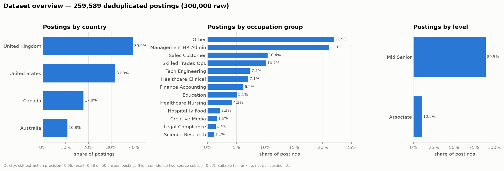
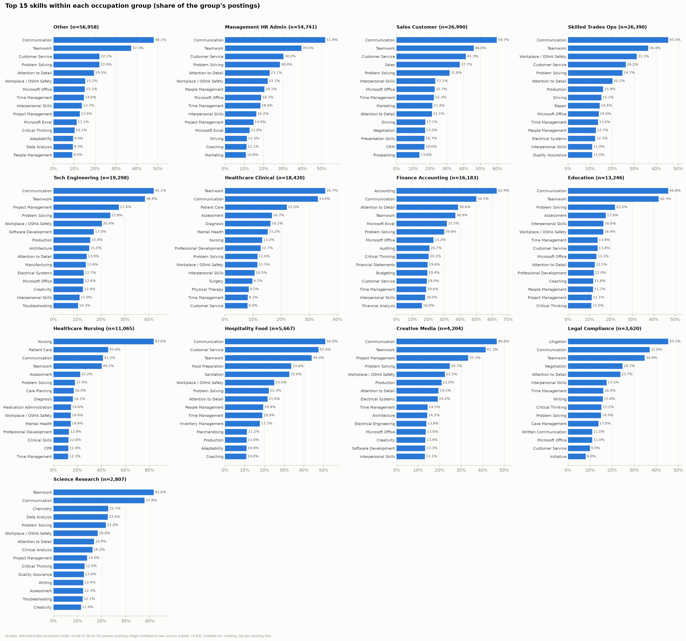
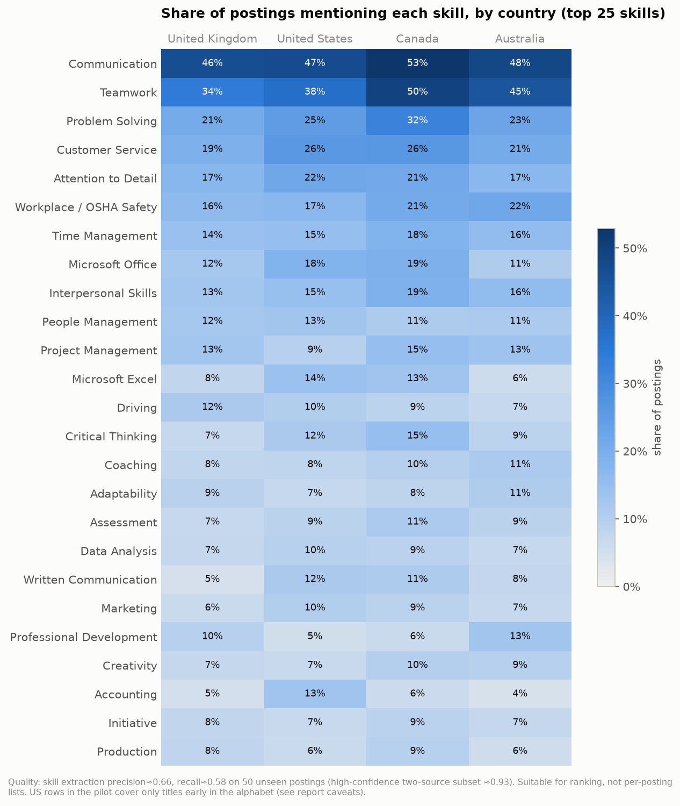
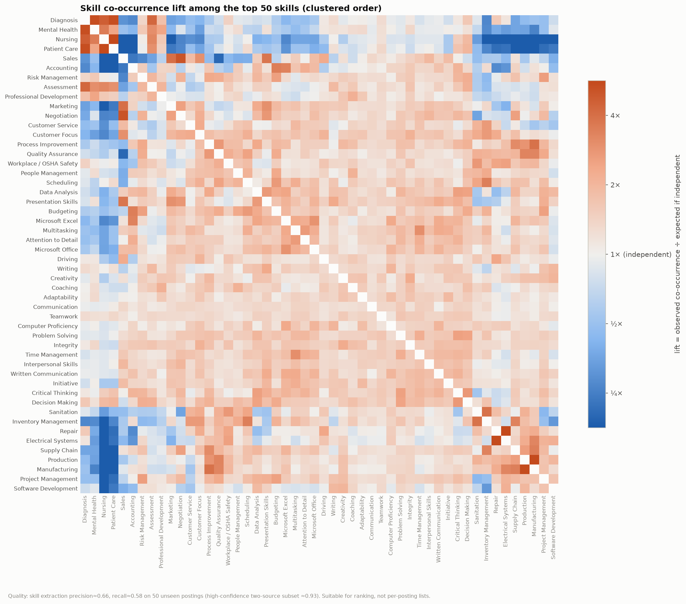
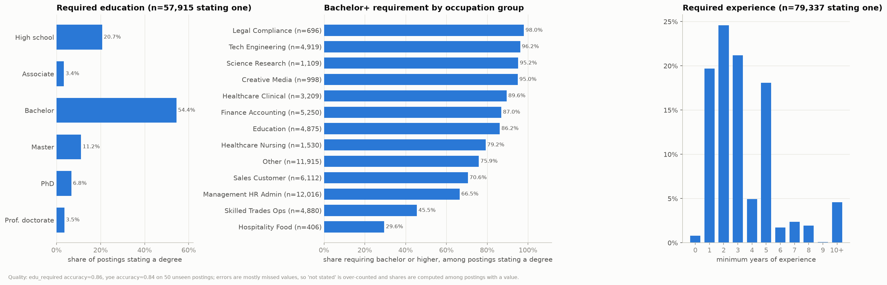
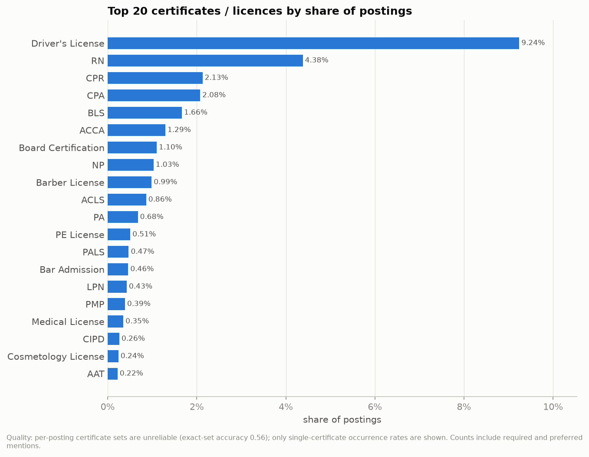
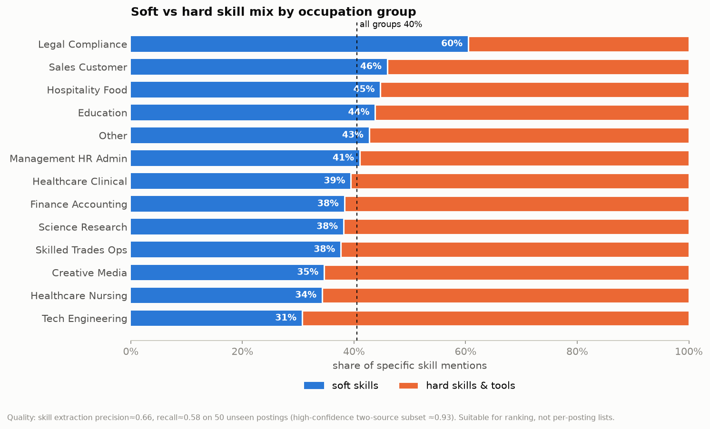

# EDA report — LinkedIn skill demand

Generated 2026-10-13T22:53:32+00:00 from `pilot` summaries: 259,589 deduplicated postings (300,000 raw), 281 specific skills.

> Quality: skill extraction precision≈0.66, recall≈0.58 on 50 unseen postings (high-confidence two-source subset ≈0.93). Suitable for ranking, not per-posting lists.

## Dataset overview

**Finding.** 259,589 postings remain after removing 13.5% duplicates; 92.7% have at least one specific skill (median 7 per posting), while only 22.3% state a degree and 30.6% state years of experience. United Kingdom is the largest country in this slice (39.6%).

*Quality: skill extraction precision≈0.66, recall≈0.58 on 50 unseen postings (high-confidence two-source subset ≈0.93). Suitable for ranking, not per-posting lists.*

## Top 30 skills overall

**Finding.** Communication (47.9%) and Teamwork (39.1%) lead; 7 of the top 10 are soft skills, and the most common non-soft skill is Workplace / OSHA Safety (17.9%). The high-confidence ranking keeps the same top 2.

*Quality: skill extraction precision≈0.66, recall≈0.58 on 50 unseen postings (high-confidence two-source subset ≈0.93). Suitable for ranking, not per-posting lists.*

## Top 15 skills by occupation group

**Finding.** Soft skills top every group, but each group has a clear signature skill: Science Research → Clinical Analysis (16.2%, 52.0× overall); Legal Compliance → Litigation (45.5%, 40.2× overall); Hospitality Food → Food Preparation (33.6%, 19.3× overall); Healthcare Nursing → Medication Administration (14.6%, 13.7× overall).

*Quality: skill extraction precision≈0.66, recall≈0.58 on 50 unseen postings (high-confidence two-source subset ≈0.93). Suitable for ranking, not per-posting lists.*

## Country differences

**Finding.** The ranking is broadly stable across countries; the widest gap is Teamwork: 49.6% in Canada vs 34.1% in United Kingdom. Second is Problem Solving (32.2% in Canada vs 20.6% in United Kingdom).

*Quality: skill extraction precision≈0.66, recall≈0.58 on 50 unseen postings (high-confidence two-source subset ≈0.93). Suitable for ranking, not per-posting lists. US rows in the pilot cover only titles early in the alphabet (see report caveats).*

## Skill co-occurrence (top 50)

**Finding.** Skills form occupational bundles rather than mixing freely; the strongest pairs among the top 50 are Nursing + Patient Care (7.9×, 8,811 postings); Electrical Systems + Repair (6.4×, 2,887 postings); Manufacturing + Production (5.5×, 5,715 postings).

*Quality: skill extraction precision≈0.66, recall≈0.58 on 50 unseen postings (high-confidence two-source subset ≈0.93). Suitable for ranking, not per-posting lists.*

## Education and experience requirements

**Finding.** Among the 22.3% of postings that state a degree, 75.9% ask for a bachelor's or higher (bachelor alone 54.4%); highest in Legal Compliance (98.0%), lowest in Hospitality Food (29.6%). Among the 30.6% stating experience, the median minimum is 3 years and 66.3% ask for 3 years or fewer.

*Quality: edu_required accuracy≈0.86, yoe accuracy≈0.84 on 50 unseen postings; errors are mostly missed values, so 'not stated' is over-counted and shares are computed among postings with a value.*

## Top 20 certificates

**Finding.** Driver's License is by far the most requested credential (9.2% of postings), followed by RN (4.4%) and CPR (2.1%); healthcare credentials account for 6 of the top 10.

*Quality: per-posting certificate sets are unreliable (exact-set accuracy 0.56); only single-certificate occurrence rates are shown. Counts include required and preferred mentions.*

## Soft vs hard skills

**Finding.** Soft skills are 40.5% of specific skill mentions overall and appear in 87.0% of postings with skills; the mix ranges from 60.5% soft in Legal Compliance to 30.7% in Tech Engineering.

*Quality: skill extraction precision≈0.66, recall≈0.58 on 50 unseen postings (high-confidence two-source subset ≈0.93). Suitable for ranking, not per-posting lists.*

## Caveats

- **Sample composition.** Inputs: `outputs/full_v8/chunks/jobs_chunk_0000.parquet` … (6 file(s)). Country mix here: United Kingdom 40%, United States 32%, Canada 18%, Australia 11%. The full run processes postings in `job_link` order, so a partial slice is not a random sample: non-US postings come first, and US postings arrive alphabetically by title slug. In the 300k pilot slice, Australia, Canada and the UK are essentially complete, but the US covers only titles from 'a' to about 'band', and the US is ~32% of the slice versus ~85% of the full corpus. Treat pilot US and overall figures as provisional; re-run with `--preset full` when the full run completes.
- **Skills.** Precision≈0.66, recall≈0.58 on 50 unseen postings: good for rankings and group comparisons, not for exact per-posting lists. The high-confidence subset (both `job_skills` and the description agree) has precision≈0.93 but lower coverage.
- **Generic labels** (`is_generic`, `(unspecified)`) such as Management, Training, Leadership, Sales are excluded by default.
- **Education / experience** are accurate when present (≈0.86 / ≈0.84) but often missed, so shares are among postings that state a value.
- **Certificates**: only single-certificate occurrence rates; required and preferred are mixed.
- **Dedup**: one posting per `dup_group_id`.
