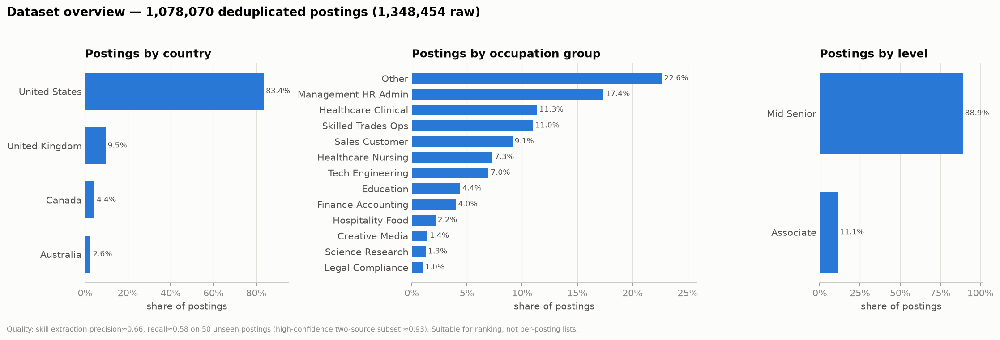
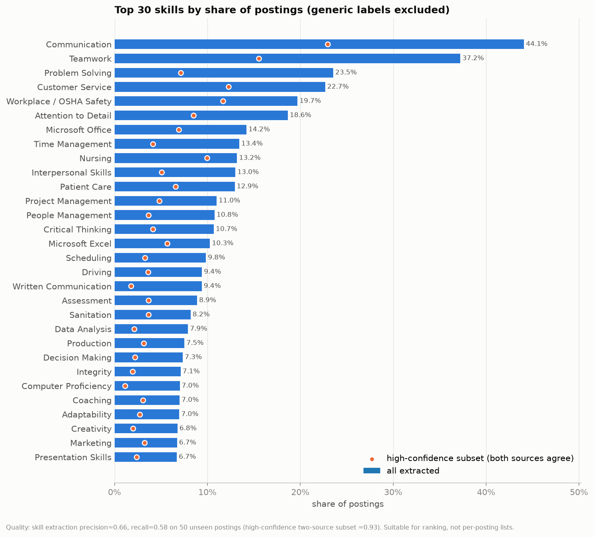
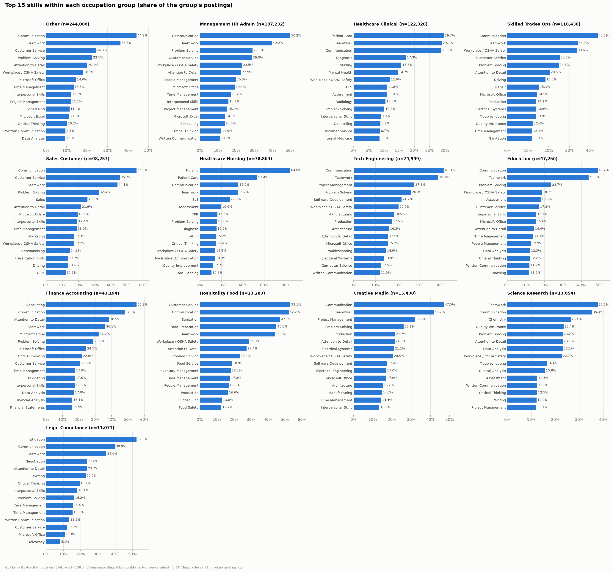
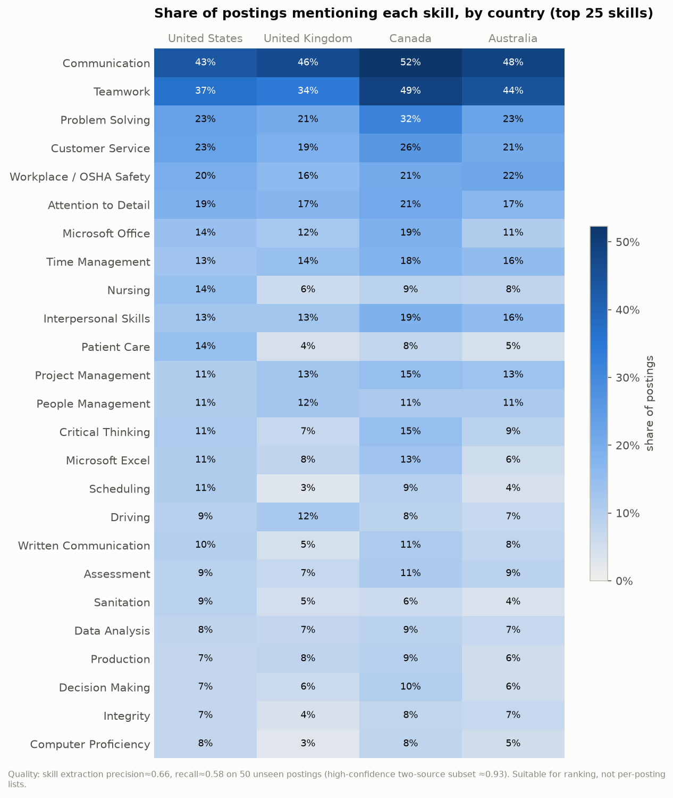
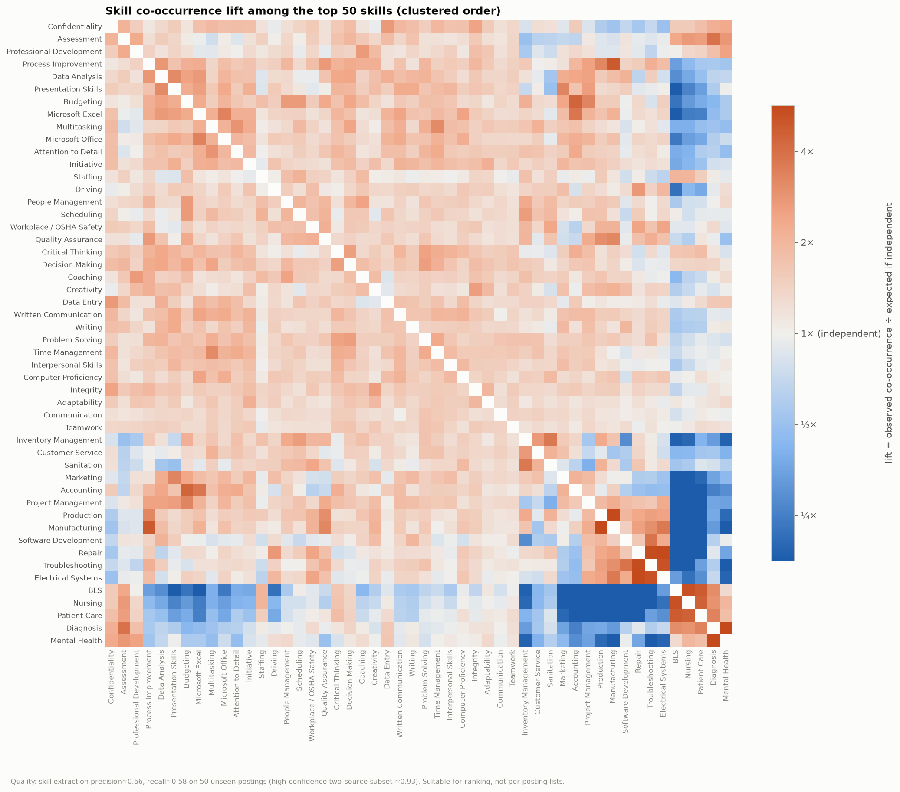
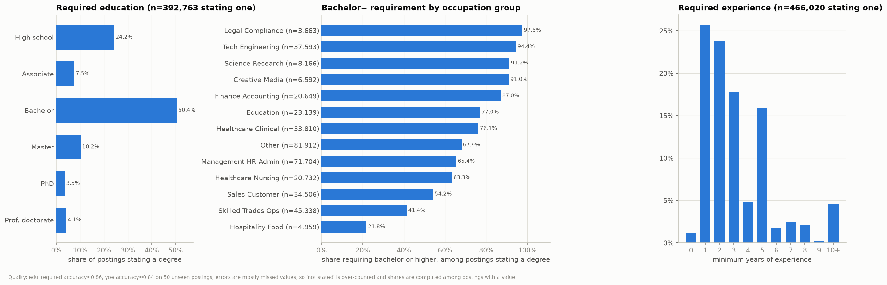
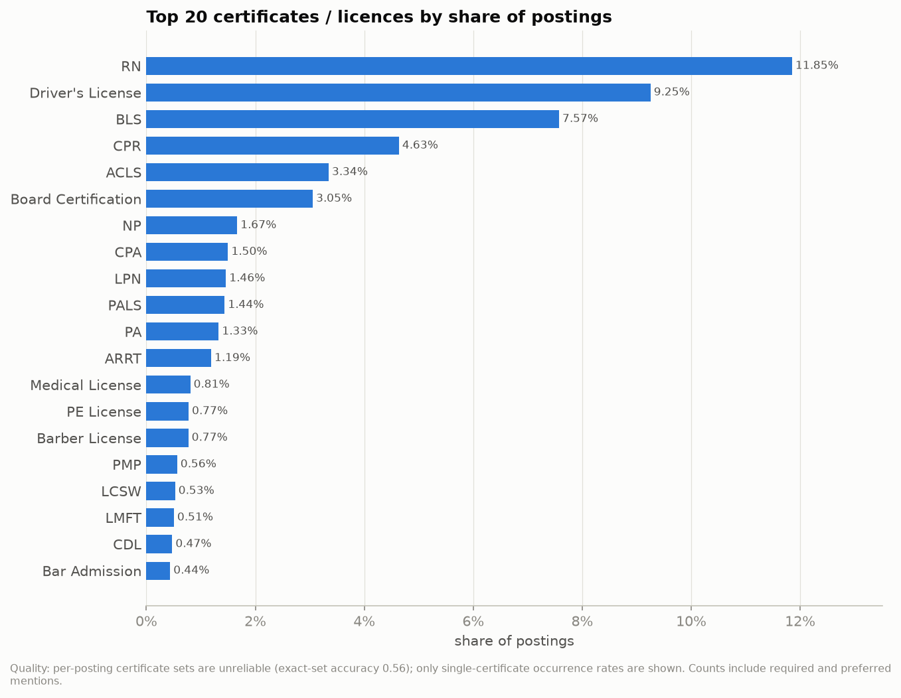
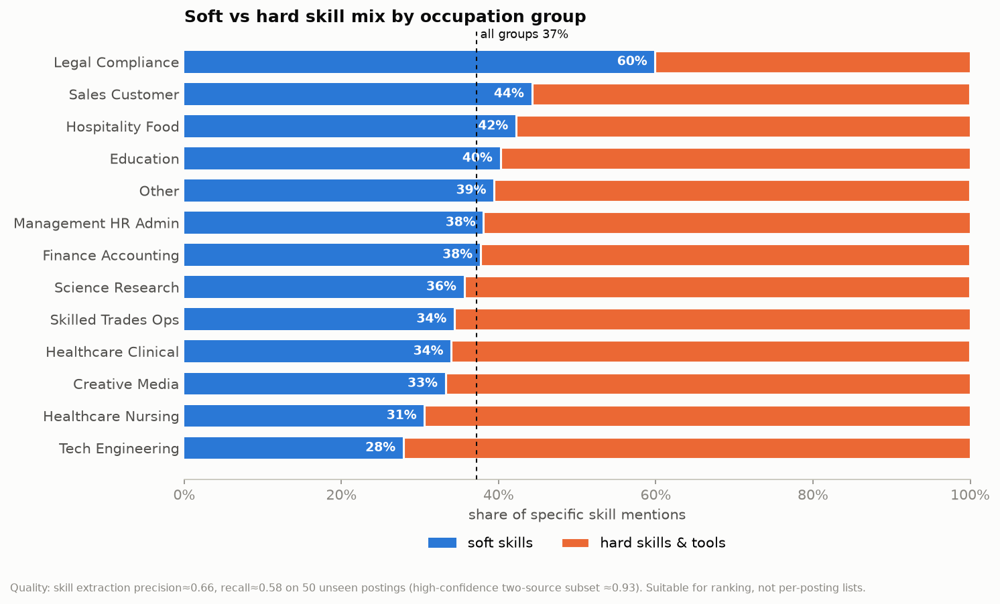

# EDA report — LinkedIn skill demand

Generated 2026-10-14T10:37:27+00:00 from `full` summaries: 1,078,070 deduplicated postings (1,348,454 raw), 281 specific skills.

> Quality: skill extraction precision≈0.66, recall≈0.58 on 50 unseen postings (high-confidence two-source subset ≈0.93). Suitable for ranking, not per-posting lists.

## Dataset overview

**Finding.** 1,078,070 postings remain after removing 20.1% duplicates; 92.7% have at least one specific skill (median 8 per posting), while only 36.4% state a degree and 43.2% state years of experience. United States is the largest country in this slice (83.4%).

*Quality: skill extraction precision≈0.66, recall≈0.58 on 50 unseen postings (high-confidence two-source subset ≈0.93). Suitable for ranking, not per-posting lists.*

## Top 30 skills overall

**Finding.** Communication (44.1%) and Teamwork (37.2%) lead; 7 of the top 10 are soft skills, and the most common non-soft skill is Workplace / OSHA Safety (19.7%). The high-confidence ranking keeps the same top 2.

*Quality: skill extraction precision≈0.66, recall≈0.58 on 50 unseen postings (high-confidence two-source subset ≈0.93). Suitable for ranking, not per-posting lists.*

## Top 15 skills by occupation group

**Finding.** Soft skills top every group, but each group has a clear signature skill: Legal Compliance → Litigation (52.3%, 54.3× overall); Science Research → Clinical Analysis (15.8%, 38.0× overall); Hospitality Food → Food Preparation (45.0%, 21.6× overall); Finance Accounting → GAAP (12.5%, 18.4× overall).

*Quality: skill extraction precision≈0.66, recall≈0.58 on 50 unseen postings (high-confidence two-source subset ≈0.93). Suitable for ranking, not per-posting lists.*

## Country differences

**Finding.** The ranking is broadly stable across countries; the widest gap is Teamwork: 48.9% in Canada vs 34.1% in United Kingdom. Second is Problem Solving (31.7% in Canada vs 20.6% in United Kingdom).

*Quality: skill extraction precision≈0.66, recall≈0.58 on 50 unseen postings (high-confidence two-source subset ≈0.93). Suitable for ranking, not per-posting lists.*

## Skill co-occurrence (top 50)

**Finding.** Skills form occupational bundles rather than mixing freely; the strongest pairs among the top 50 are Electrical Systems + Repair (6.5×, 14,280 postings); Manufacturing + Production (5.8×, 27,133 postings); Diagnosis + Mental Health (5.7×, 17,093 postings).

*Quality: skill extraction precision≈0.66, recall≈0.58 on 50 unseen postings (high-confidence two-source subset ≈0.93). Suitable for ranking, not per-posting lists.*

## Education and experience requirements

**Finding.** Among the 36.4% of postings that state a degree, 68.3% ask for a bachelor's or higher (bachelor alone 50.4%); highest in Legal Compliance (97.5%), lowest in Hospitality Food (21.8%). Among the 43.2% stating experience, the median minimum is 2 years and 68.3% ask for 3 years or fewer.

*Quality: edu_required accuracy≈0.86, yoe accuracy≈0.84 on 50 unseen postings; errors are mostly missed values, so 'not stated' is over-counted and shares are computed among postings with a value.*

## Top 20 certificates

**Finding.** RN is by far the most requested credential (11.8% of postings), followed by Driver's License (9.3%) and BLS (7.6%); healthcare credentials account for 8 of the top 10.

*Quality: per-posting certificate sets are unreliable (exact-set accuracy 0.56); only single-certificate occurrence rates are shown. Counts include required and preferred mentions.*

## Soft vs hard skills

**Finding.** Soft skills are 37.1% of specific skill mentions overall and appear in 84.0% of postings with skills; the mix ranges from 59.9% soft in Legal Compliance to 27.9% in Tech Engineering.

*Quality: skill extraction precision≈0.66, recall≈0.58 on 50 unseen postings (high-confidence two-source subset ≈0.93). Suitable for ranking, not per-posting lists.*

## Caveats

- **Sample composition.** Inputs: `outputs/full_v8/jobs_v8.parquet` … (1 file(s)). Country mix here: United States 83%, United Kingdom 10%, Canada 4%, Australia 3%. These are all postings of the full run. They come from LinkedIn searches in four English-speaking countries in early 2024 and are not a random sample of the labour market.
- **Skills.** Precision≈0.66, recall≈0.58 on 50 unseen postings: good for rankings and group comparisons, not for exact per-posting lists. The high-confidence subset (both `job_skills` and the description agree) has precision≈0.93 but lower coverage.
- **Generic labels** (`is_generic`, `(unspecified)`) such as Management, Training, Leadership, Sales are excluded by default.
- **Education / experience** are accurate when present (≈0.86 / ≈0.84) but often missed, so shares are among postings that state a value.
- **Certificates**: only single-certificate occurrence rates; required and preferred are mixed.
- **Dedup**: one posting per `dup_group_id`.
